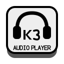
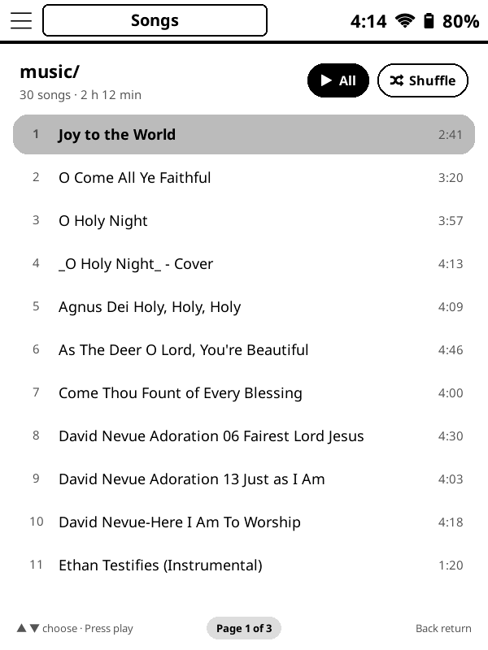
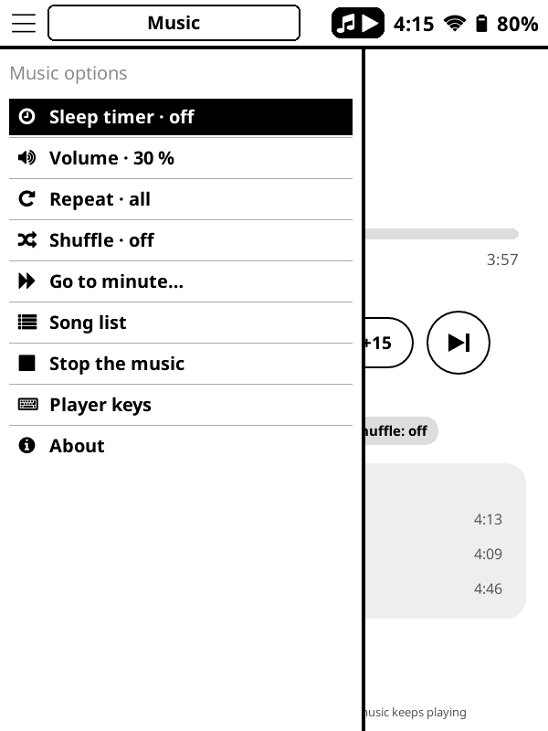
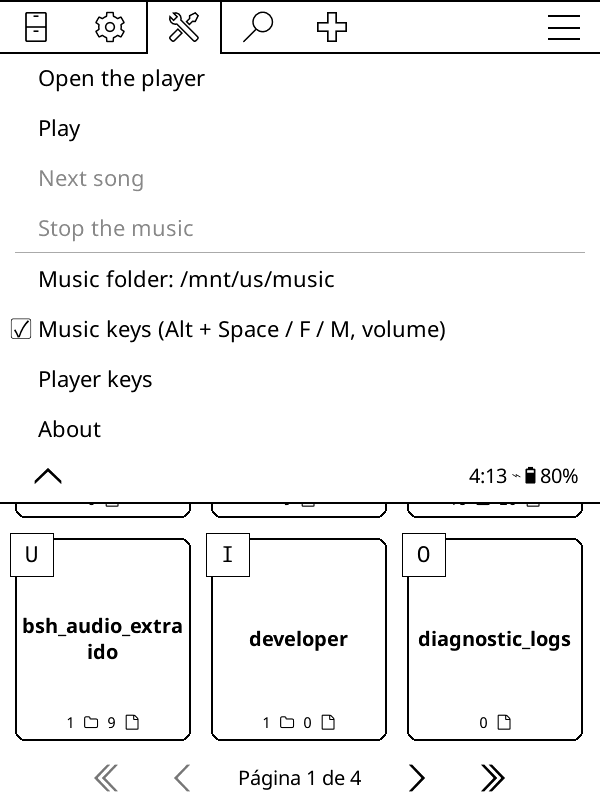
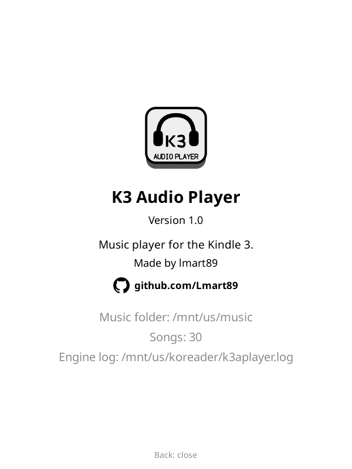

🌐 <b>English</b> · <a href="readme-es.md">Español</a>

# K3aPlayer

**K3 Audio Player**: an audio player for the **Kindle 3 (Keyboard)** built on [KOReader](https://koreader.rocks/).

It uses the device's **own audio hardware**: the built-in speakers and the **3.5 mm headphone jack**. No Bluetooth, no adapters.

Version 1.0 · made by lmart89 · [github.com/Lmart89](https://github.com/Lmart89)

  
  

  
  

## Why Kindle 3 only?

The Kindle 3 is one of the few Kindles with dedicated audio hardware (speakers and a headphone jack). Newer models rely on Bluetooth to play sound. K3aPlayer is built to take advantage of exactly that, which is why this is a version specific to this device.

## Features

- Plays **MP3** files stored on the Kindle.
- **"Now playing"** screen with the track title, file name and position in the list (for example, *Song 6 of 30*).
- **Progress bar** with elapsed time and total duration.
- Controls: **previous**, **−15 s**, **play/pause**, **+15 s** and **next**.
- Adjustable **volume**.
- **Repeat** (for example, *all*) and **Shuffle**.
- **"Up next"** queue showing the upcoming songs and their duration.
- **Music keeps playing** when you go back to read or use another KOReader feature.
- **Song list** with *All* and *Shuffle*, and **Sleep timer** and **Go to minute** in the options panel.
- Works with the K3's physical keys: arrows to select, *Press* to activate and *Menu* for options.
- **Global keys** anywhere in KOReader: *Alt + Space* play / pause, *Alt + F* next song, *Alt + M* open the player, and the **volume keys**.
- Also available as KOReader **Dispatcher** actions (gestures, profiles).
- **About** screen with the app icon, version, author and GitHub address.
- Interface in **English**.

## How it works

The Kindle 3 ships with GStreamer 0.10 and a hardware MP3 decoder (`mfw_mp3decoder`), which its native MP3 player uses. K3aPlayer includes no decoder of its own: it starts a small engine (`k3aplayer_engine.lua`) as a separate process with KOReader's `luajit`, which drives GStreamer through FFI (`fdsrc ! mfw_mp3decoder ! audioconvert ! audioresample ! volume ! alsasink`). The plugin sends it commands over a FIFO and reads its status once a second, so the music keeps playing while you read. Seeking reopens the file at the right byte, which on the K3 is much faster than GStreamer's own seek.

On the K3, KOReader paints everything in Lua, so the screens repaint only the part that changes, the buttons and cover are SVG icons rendered once and then copied, and the screen is kept in memory to come back instantly after the options panel or a notice. The interface is built with KOReader's widgets.

## Requirements

- A **jailbroken** Kindle 3 (Keyboard).
- **KOReader** installed on the Kindle (a legacy version compatible with the K3).
- MP3 audio files stored on the Kindle.

## Installation

> These steps are a guide; adjust the paths to your own setup.

**As a KOReader plugin**

1. Connect the Kindle to your computer over USB.
2. Copy the `k3aplayer.koplugin` folder into `koreader/plugins/`.
3. Eject the Kindle and restart KOReader. The player is in **Main menu → Tools → Music player**.

**As a standalone app**

Coming soon: a version that opens the player directly, without the rest of KOReader's features.

## Roadmap

- [ ] Standalone app version.
- [ ] Internet radio (BBN Radio) via streaming.

## Disclaimer

K3aPlayer is an independent community project. It is not affiliated with or endorsed by Amazon or the KOReader project. *Kindle* is a registered trademark of Amazon.com, Inc.

## License

K3aPlayer is released under the **GNU AGPL-3.0** license, the same as KOReader, from which it is derived. See the `LICENSE` file.

## Acknowledgments

- The [KOReader](https://github.com/koreader/koreader) team and community, whose work makes this project possible.
