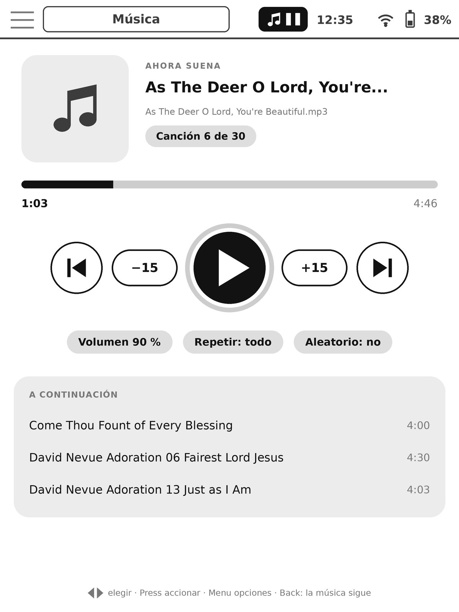

# K3aPlayer

**K3 Audio Player**: reproductor de audio para el **Kindle 3 (Keyboard)** sobre [KOReader](https://koreader.rocks/).

Usa el audio **del propio dispositivo**: los parlantes integrados y la salida de **Jack de 3.5 mm**. Sin Bluetooth, sin adaptadores.

  

## ¿Por qué solo el Kindle 3?

El Kindle 3 es de los pocos Kindle con hardware de audio dedicado (parlantes y Jack). Los modelos más recientes dependen del Bluetooth para reproducir sonido. K3aPlayer está pensado para aprovechar justamente esa ventaja y por eso es una versión específica para este dispositivo.

## Características

- Reproduce archivos **MP3** desde la memoria del Kindle.
- Pantalla **"Ahora suena"** con título, nombre del archivo y posición en la lista (por ejemplo, *Canción 6 de 30*).
- **Barra de progreso** con tiempo transcurrido y duración total.
- Controles: **anterior**, **−15 s**, **reproducir/pausa**, **+15 s** y **siguiente**.
- **Volumen** ajustable.
- **Repetir** (por ejemplo, *todo*) y **Aleatorio**.
- Cola **"A continuación"** con las próximas canciones y su duración.
- **La música sigue sonando** al volver atrás para leer o usar otra función de KOReader.
- Manejo con los botones físicos del K3: flechas para elegir, *Press* para accionar y *Menu* para las opciones.

## Cómo funciona

El Kindle 3 ya trae un servicio de audio basado en GStreamer (`com.lab126.audio`, ejecutado por `audioServer`), que es el que usa su reproductor nativo de MP3. K3aPlayer no incluye ningún decodificador propio: le envía las órdenes de reproducción a ese servicio mediante `lipc` (crear, iniciar, pausar, buscar posición, volumen) y la interfaz está construida con los widgets de KOReader.

## Requisitos

- Kindle 3 (Keyboard) con **jailbreak**.
- **KOReader** instalado en el Kindle (versión legacy compatible con el K3).
- Archivos de audio MP3 en la memoria del Kindle.

## Instalación

> Estos pasos son una guía; ajusta las rutas a tu instalación.

**Como plugin de KOReader**

1. Conecta el Kindle al computador por USB.
2. Copia la carpeta `k3aplayer.koplugin` dentro de `koreader/plugins/`.
3. Expulsa el Kindle, abre KOReader y activa el plugin desde el menú.

**Como app independiente**

Próximamente: una versión que abre directamente el reproductor, sin el resto de funciones de KOReader.

## Hoja de ruta

- [ ] Versión como app independiente.
- [ ] Radio por internet (BBN Radio) mediante streaming.

## Aviso

K3aPlayer es un proyecto independiente de la comunidad. No está afiliado ni respaldado por Amazon ni por el proyecto KOReader. *Kindle* es una marca registrada de Amazon.com, Inc.

## Licencia

K3aPlayer se distribuye bajo la licencia **GNU AGPL-3.0**, la misma de KOReader, del cual se deriva. Consulta el archivo `LICENSE`.

## Agradecimientos

- Al equipo y a la comunidad de [KOReader](https://github.com/koreader/koreader), cuyo trabajo hace posible este proyecto.
