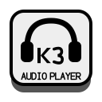
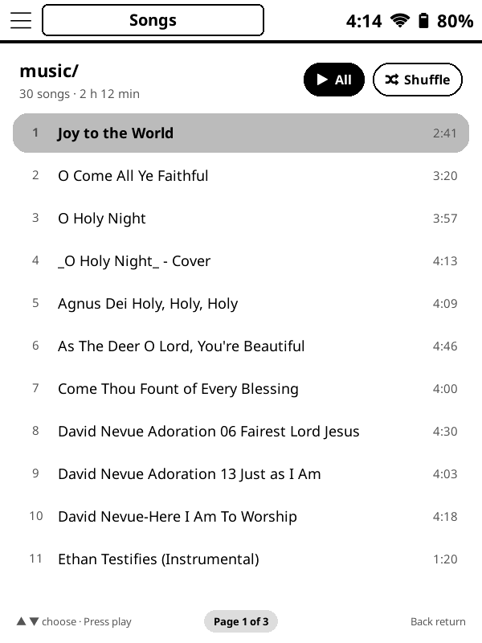
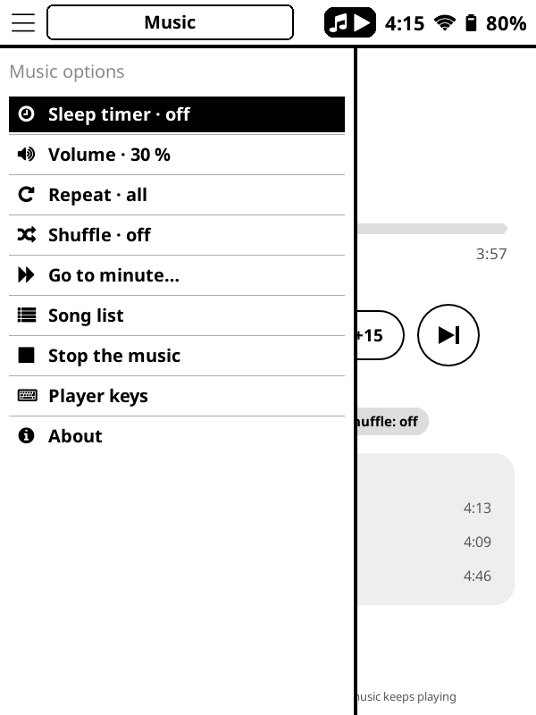
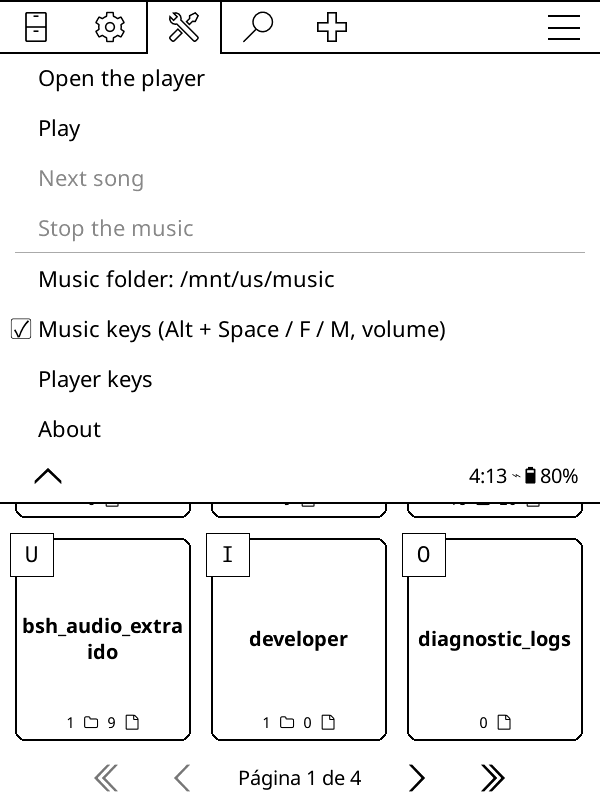
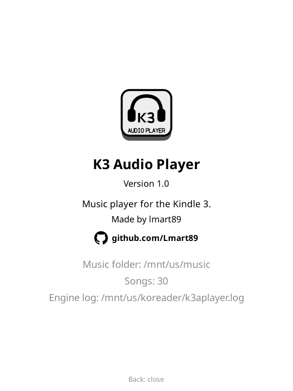

🌐 <a href="README.md">English</a> · <b>Español</b>

# K3aPlayer

**K3 Audio Player**: reproductor de audio para el **Kindle 3 (Keyboard)** sobre [KOReader](https://koreader.rocks/).

Usa el audio **del propio dispositivo**: los parlantes integrados y la salida de **Jack de 3.5 mm**. Sin Bluetooth, sin adaptadores.

Versión 1.0 · elaborado por lmart89 · [github.com/Lmart89](https://github.com/Lmart89)

  
  

  
  

La interfaz está en inglés.

## ¿Por qué solo el Kindle 3?

El Kindle 3 es de los pocos Kindle con hardware de audio dedicado (parlantes y Jack). Los modelos más recientes dependen del Bluetooth para reproducir sonido. K3aPlayer está pensado para aprovechar justamente esa ventaja y por eso es una versión específica para este dispositivo.

## Características

- Reproduce archivos **MP3** desde la memoria del Kindle.
- Pantalla **"Ahora suena"** con título, nombre del archivo y posición en la lista (por ejemplo, *Canción 6 de 30*).
- **Barra de progreso** con tiempo transcurrido y duración total.
- Controles: **anterior**, **−15 s**, **reproducir/pausa**, **+15 s** y **siguiente**.
- **Volumen** ajustable.
- **Repetir** (por ejemplo, *todo*) y **Aleatorio**.
- Cola **"A continuación"** con las próximas canciones y su duración.
- **La música sigue sonando** al volver atrás para leer o usar otra función de KOReader.
- **Lista de canciones** con *All* (todo) y *Shuffle* (aleatorio), y **temporizador de apagado** e **ir al minuto** en el menú de opciones.
- Manejo con los botones físicos del K3: flechas para elegir, *Press* para accionar y *Menu* para las opciones.
- **Teclas globales** en cualquier parte de KOReader: *Alt + Espacio* reproducir / pausa, *Alt + F* canción siguiente, *Alt + M* abrir el reproductor, y las **teclas de volumen**.
- También como acciones del **Dispatcher** de KOReader (gestos, perfiles).
- Pantalla **About** con el icono de la app, la versión, el autor y la dirección de GitHub.

## Cómo funciona

El Kindle 3 trae GStreamer 0.10 y un decodificador MP3 por hardware (`mfw_mp3decoder`), el mismo que usa su reproductor nativo. K3aPlayer no incluye ningún decodificador propio: arranca un pequeño motor (`k3aplayer_engine.lua`) como proceso aparte con el `luajit` de KOReader, que maneja GStreamer por FFI (`fdsrc ! mfw_mp3decoder ! audioconvert ! audioresample ! volume ! alsasink`). El plugin le envía las órdenes por una FIFO y lee su estado cada segundo, así la música sigue sonando mientras lees. Para saltar a otro punto reabre el archivo en el byte exacto, mucho más rápido en el K3 que la búsqueda de GStreamer.

En el K3, KOReader pinta todo en Lua, así que las pantallas repintan solo la parte que cambia, los botones y la portada son iconos SVG que se dibujan una vez y luego se copian, y la pantalla se guarda en memoria para volver al instante tras el menú de opciones o un aviso. La interfaz está construida con los widgets de KOReader.

## Requisitos

- Kindle 3 (Keyboard) con **jailbreak**.
- **KOReader** instalado en el Kindle (versión legacy compatible con el K3).
- Archivos de audio MP3 en la memoria del Kindle.

## Instalación

> Estos pasos son una guía; ajusta las rutas a tu instalación.

**Como plugin de KOReader**

1. Conecta el Kindle al computador por USB.
2. Copia la carpeta `k3aplayer.koplugin` dentro de `koreader/plugins/`.
3. Expulsa el Kindle y reinicia KOReader. El reproductor está en **Menú principal → Herramientas → Music player**.

**Como app independiente**

Próximamente: una versión que abre directamente el reproductor, sin el resto de funciones de KOReader.

## Hoja de ruta

- [ ] Versión como app independiente.
- [ ] Radio por internet (BBN Radio) mediante streaming.

## Aviso

K3aPlayer es un proyecto independiente de la comunidad. No está afiliado ni respaldado por Amazon ni por el proyecto KOReader. *Kindle* es una marca registrada de Amazon.com, Inc.

## Licencia

K3aPlayer se distribuye bajo la licencia **GNU AGPL-3.0**, la misma de KOReader, del cual se deriva. Consulta el archivo `LICENSE`.

## Agradecimientos

- Al equipo y a la comunidad de [KOReader](https://github.com/koreader/koreader), cuyo trabajo hace posible este proyecto.
